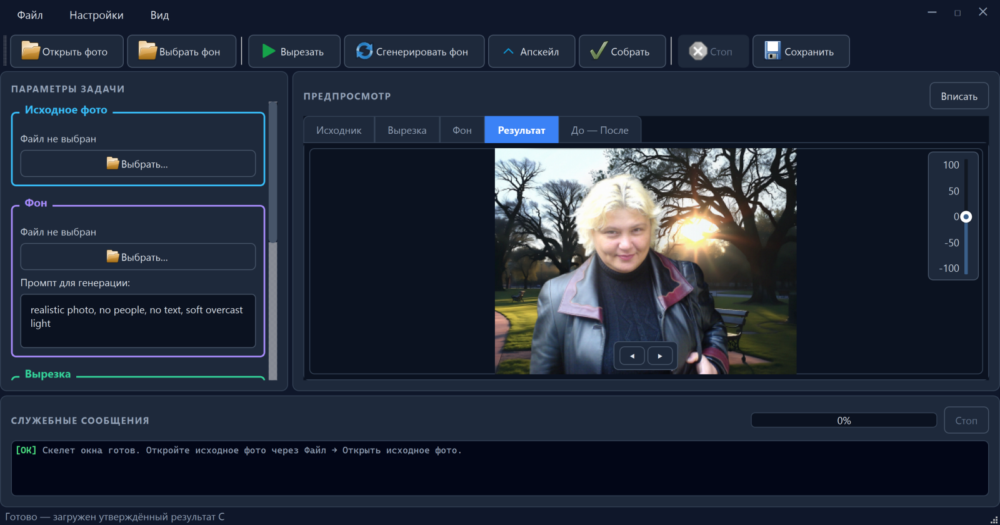

# Photo

Проект обработки фотографий: вырезка объекта, генерация и замена фона, апскейл и композит.



- Корень: `C:\My_projects\Photo`
- Данные: `data\` (черновики — `data\bg\`, утверждённые результаты — `data\results\`)
- Код: `main.py` (GUI), `src\ui\` (интерфейс), `src\core\` (основная логика), `src\photo_pipeline.py`, `src\contact_sheet.py` (CLI)
- Модели: `models\` (ONNX)
- Документация: [docs/README.md](docs/README.md)
- Утверждённый результат: [data/results/2026-11-17-park-c](data/results/2026-11-17-park-c/README.md)

## Запуск

GUI:

```powershell
Set-Location "C:\My_projects\Photo"
& .venv\Scripts\python.exe main.py
```

CLI (пайплайн остаётся рабочим):

```powershell
$root = "C:\My_projects\Photo"
$data = "$root\data"
$py = "$root\.venv\Scripts\python.exe"
$pp = "$root\src\photo_pipeline.py"
Set-Location $root

& $py $pp cut "C:\Users\bur_s\OneDrive\Изображения\DSC00103.JPG" "$data\DSC00103-cut.png"
& $py $pp genbg "скалистый берег, чайки, облачно" "$data\bg\park.jpg" --provider cloudflare --size 2K
& $py $pp upscale "$data\bg\park.jpg" "$data\bg\park-2x.jpg" --factor 2
& $py $pp composite "$data\DSC00103-cut.png" "$data\bg\park-2x.jpg" "$data\final.jpg" --blur 0.5
```

## Возможности интерфейса

### Окно

- Безрамочное окно со скруглёнными углами. При запуске центрируется в рабочей области экрана и занимает 85 % её площади (минимальный размер 800×600).
- Кнопки `─ / □ / ❐ / ✕` справа в строке меню: свернуть, развернуть/восстановить, закрыть. Окно перетаскивается за пустое место в меню, растягивается мышью за края и углы (стандартные курсоры Windows).
- Три зоны: меню с панелью инструментов, результат (параметры слева + предпросмотр справа), служебные сообщения (прогресс, «Стоп», лог). Все три можно скрыть через меню `Вид`.

### Меню

- **Файл** — открыть исходное фото (`Ctrl+O`), открыть фон, сохранить результат в JPEG (`Ctrl+S`), выход. Диалоги открытия стартуют в папке последнего выбранного файла (отдельно для фото и фона) и возвращаются на `data\`, если этой папки больше нет — удобно, когда фото грузятся из архива или с внешнего диска.
- **Настройки** — сразу открывает диалог, без субменю.
- **Вид** — только компоновка: тёмная/светлая тема и показ панели задач, панели инструментов, панели сообщений.
- **О программе** — окно с объяснением, для чего нужно приложение, из каких шагов состоит работа и какие инструменты используются; написано простым языком. Там же коротко описаны похожие сервисы и отличия от них. Подробный анализ рынка — в [docs/07-market-analysis.md](docs/07-market-analysis.md).

### Панель инструментов

`Открыть фото`, `Выбрать фон`, `Вырезать`, `Сгенерировать фон`, `Апскейл`, `Собрать`, `Стоп`, `Сохранить`. Кнопки выбора фото и фона используют иконку папки; цветные значки не меняются при смене темы. Четыре операции обработки запускаются в фоновом потоке; во время работы они недоступны, а кнопки `Стоп` — наоборот, активны. Кнопка `Сгенерировать фон` на тулбаре осталась и дублирует две новые — под промптом в панели задач и в диалоге настроек: все три вызывают один и тот же метод.

### Параметры задачи (левая панель)

Панель имеет фиксированную ширину 340 px (`PARAMS_WIDTH` в `src\ui\main_window.py`) и не меняется при генерации фона, загрузке изображений, длинных путях и изменении размера окна: `setFixedWidth()` важнее стартовых пропорций `QSplitter.setSizes()`. Метки путей при этом переносятся внутри своей ширины и не растягивают панель.

Четыре блока с разным цветом рамок и заголовков:

- **Исходное фото** — путь и кнопка `Выбрать…`.
- **Фон** — путь, кнопка `Выбрать…`, промпт для генерации и кнопка `Сгенерировать фон` сразу под промптом. Она работает так же, как кнопка на тулбаре; после успешной генерации приложение само переключается на вкладку `Фон`. Промпт можно писать по-русски: он автоматически переводится на английский, а упоминания разрешения («в 2К») удаляются — размер задаётся отдельным пресетом.
- **Вырезка** — модель BiRefNet/ISNet, портретный режим, кнопка `Вырезать объект`.
- **Композит** — ползунки размытия фона, контактной тени, подгонки яркости и зерна, кнопка `Собрать композит`.

### Предпросмотр

- Вкладки: `Исходник`, `Вырезка`, `Фон`, `Результат`, `До — После`. После загрузки фото вкладка `Исходник` открывается автоматически. Фон загружается один раз (диалогом, генерацией или апскейлом) — перебора фонов больше нет. При загрузке фона вкладка `Фон` открывается автоматически.
- В шапке зоны `ПРЕДПРОСМОТР` рядом с заголовком показывается имя и разрешение файла активной вкладки: `DSC00103.JPG · 1632×1224`. Для `До — После` обе подписи объединяются стрелкой: `source.jpg · 1632×1224  →  final.jpg · 3264×2448`. Разрешение берётся из заголовка файла (`QImageReader.size()`), а не из уменьшенного предпросмотра: для крупного кадра видно настоящий размер, хотя окно показывает копию до 4096 px. При наведении всплывает полный путь и вес файла; длинное имя сокращается по середине, расширение остаётся видимым. Подпись обновляется при загрузке, очистке и смене вкладки.
- В нижнем информационном окне появляются контекстные подсказки уровня `[HINT]`: по одному совету на текущее состояние, без повторов. Например: «Вырежьте объект», «Выберите готовый фон или опишите его…», «Фон 1024×768 меньше исходника 1632×1224 — сделайте апскейл ×2. Размер результата останется 1632×1224», «Фон 2048×1536 не мельче исходника — апскейл не нужен, собирайте композит», «Результат готов — сохраните его». Отдельно напоминается, если исходник заменили после вырезки или фон — после сборки. Если нажать `Собрать` без вырезки, в инфоокне появляется отдельный совет «Для сборки не хватает вырезки текущего фото — вырежьте объект…»; сборка при этом не запускается. Совет не запускает операцию: вырезка долгая, а генерация платная, поэтому решение остаётся за пользователем.
- В том же ряду, что и вкладки, справа стоят кнопки `Очистить` и `Сохранить`. `Очистить` сбрасывает предпросмотр текущей вкладки (`Вырезка`, `Фон`, `Результат`, `До — После`), чтобы переделать неудачный этап; для `Фон` она ещё снимает выбранный путь, а для `До — После` очищает обе половинки. Файлы на диске не удаляются — в логе явно говорится, что очищен только предпросмотр. После очистки `Сохранить` блокируется: сохранять уже нечего. `Сохранить` пишет изображение текущей вкладки через диалог (`Вырезка` — `cutout.png` с альфой, `Фон` — `background.jpg`, `Результат` — `result.jpg`, `До — После` — одно изображение `before-after.jpg` с половинками рядом). Обе кнопки неактивны для `Исходника`, пустых вкладок и во время выполнения операции. Диалог запоминает последнюю папку в ключе `paths/last_save_dir`. Так промежуточный файл можно открыть в Photoshop, поправить и собрать композит заново.
- Для большого или низкоконтрастного кадра в правом верхнем углу зоны изображения вкладки `Исходник` всплывает предупреждение (левее шкалы масштаба). Оно гаснет через 5 секунд, закрывается крестиком в квадрате и пропадает при уходе с вкладки; при наведении системная подсказка не показывается. Крест нарисован линиями строго по центру кнопки, поэтому не смещён относительно рамки. Те же предупреждения дублируются в лог нижней зоны.
- Масштаб обозначается кратностью вместо процентов: вертикальная шкала `×4 / ×2 / ×1 / ÷2` закреплена в правом верхнем углу страницы вкладки. `×1` — вписанный кадр, вверх до `×4`, вниз до `÷2`; шаг колеса соответствует 5 единицам ползунка. Меняется колесом в любой точке зоны фото или ползунком; кнопка `Вписать` сбрасывает масштаб и смещение. Шкала выполнена лёгкой: полупрозрачный фон без рамки, мелкие приглушённые подписи, тонкий паз и маленькая ручка.
- Панорамирование: фото перемещается зажатой левой кнопкой; курсор — открытая рука при наведении, сжатая при перетаскивании. Смещение ограничено границами изображения.
- Оверлей масштаба прозрачен в покое, проявляется при наведении или своём действии и гаснет через 5 секунд. Он не выходит за рамку фото.
- Масштаб блокируется, если в текущей вкладке нет изображения (актуально для пустых `Вырезки` и `Результата`).

### Сообщения и настройки

- Нижняя зона показывает прогресс, кнопку `Стоп` и цветной лог уровней `OK / INFO / WARN / ERROR`.
- Диалог настроек: вкладки `Модели`, `Вырезка`, `Фон`, `Композит`, `Апскейл`, `Пути`, `Общие`. Значения сохраняются в `QSettings` (`Photo/Photo`), в том числе тема и видимость панелей. Ключи API хранятся вне репозитория. Под выбором провайдера во вкладке `Модели` показывается сводка «Сейчас: Cloudflare · @cf/black-forest-labs/flux-1-schnell / ключ найден» — активный провайдер, его модель и статус ключа; надпись обновляется при смене провайдера (у Pollinations — «ключ не нужен»). Во вкладке `Общие` есть переключатель `Подсказки в инфоокне` (ключ `ui/hints`, по умолчанию включены) — если советы мешают, их можно отключить; после повторного включения текущий совет появится снова. Во вкладке `Фон` под промптом стоит кнопка `Сгенерировать фон`: она применяет настройки, закрывает диалог и сразу запускает генерацию. Там же есть пресет **«Размер фона»** `1K / 2K / 4K` (1024×768 / 2048×1536 / 4096×3072, по умолчанию `2K`) — это конечный размер файла, а не слова в промпте. Если провайдер отдаёт меньше, результат проходит ESRGAN ×4 и доводится до нужного размера — реальная детализация при этом ограничена возможностями подключённой модели.
- Сохранение результата — `data\result.jpg` из вкладки `Результат`.

### Предустановки по умолчанию

При первом запуске GUI однократно выставляет проверенные значения, с которыми получен утверждённый результат C (`docs\04-result-2026-11-17-park-c.md`): модель вырезки `birefnet-general`, тайл `1024`, сигма `1.4`, доля головы `0.34`, портретный режим и pymatting включены; размытие фона композита `0.5`, провайдер `cloudflare`. Это исправляет устаревшие ключи вроде `cut/model = u2netp` и `compose/blur = 0.72`, из-за которых вырезка стала хуже. После первой миграции (`app/defaults_version`) пользовательские изменения не перетираются. Единый список предустановок — `src\ui\defaults.py`.

### Обработка

`Вырезать`, `Сгенерировать фон`, `Апскейл` и `Собрать` вызывают логику `src\core\` через `CoreWorker` (`QThread`). Нижняя зона показывает прогресс в процентах (сетевые этапы — неопределённый режим), обе кнопки `Стоп` активны, а кнопки обработки на время запуска выключены. Отмена кооперативная: операция останавливается на следующей точке ядра (между тайлами или провайдерами), после чего интерфейс возвращается в обычное состояние. Ошибки попадают в лог уровнем `ERROR`.

- **Вырезка** — модель из панели задач, портретный режим, размер тайла, сигма, доля головы и pymatting из настроек. Кадр покрывается сеткой тайлов с 50 % перекрытием (для кадров до 2048 px на сторону схема из двух тайлов сохранена для совместимости с утверждённым результатом). Если тайл вышел почти сплошь непрозрачным — модель не нашла в нём объект и приняла фон за передний план — он повторяется с захватом соседней области, чтобы у модели был контекст. Дополнительно кадр проверяется целиком: пропущенные тайлами области восстанавливаются по цельной маске с цветом из исходника, а зазоры между руками и ногами остаются прозрачными. Файл `data\work\cutout.png` открывается во вкладке `Вырезка`; если в момент завершения активна другая вкладка, приложение само переключается на `Вырезку`, чтобы результат был сразу виден.
- **Генерация фона** — провайдер, seed и пресет размера из настроек, промпт из панели задач. Поле промпта начинается пустым: внутри видна подсказка «Создай реалистичное фото северного сияния на ночном небе», она исчезает при вводе. Текст не сохраняется между запусками. Русский промпт переводится на английский через публичный endpoint (без ключа), «2К» из текста удаляется; обязательная фраза `realistic photo, no people, no text` дополняется только недостающими частями. Запустить можно из тулбара, из панели задач или из диалога настроек (там настройки применяются перед запуском). Файл `data\bg\generated-<дата>-<время>.jpg` сразу открывается, и вкладка `Фон` становится текущей — даже если в момент завершения смотрели другую вкладку. Перевод и размер можно задать и в CLI: `genbg "<промпт>" out.jpg --provider cloudflare --size 2K`.
- **Апскейл** — ×2 (модель EDSR, по умолчанию) или ×4 (realesr-general-x4v3) для выбранного фона; кратность задаётся во вкладке настроек `Апскейл`. Результат `<имя>-2x<расширение>` / `<имя>-4x<расширение>` рядом с источником, открывается во вкладке `Фон`, которая сразу становится текущей. ×2 выбран по итогам сравнения на макро-снимках: он заметно лучше сохраняет мелкие детали и не медленнее ×4; ×4 остаётся доступным для совпадения со стилем утверждённого результата. Внутренняя доводка размеров фона всегда использует ×4 независимо от настройки. Крупные кадры (например, 15360×8640) показываются уменьшенным предпросмотром до 4096 px по большой стороне, чтобы не было ошибки «Не удалось прочитать изображение»; «Сохранить» при этом пишет полное разрешение из исходного файла. Об уменьшении честно предупреждает всплывашка над превью, та же фраза дублируется в нижнее информационное окно (`[WARN]`). Для небольших кадров предупреждения нет.
- **Сборка композита** — из вырезки текущей сессии и выбранного фона с текущими ползунками и seed из настроек. Файл `data\work\cutout.png`, оставшийся от предыдущего запуска, не используется: если вырезки в сессии нет или исходник заменили после вырезки, кнопка `Собрать` не запускает операцию и объясняет причину в инфоокне. Файл `data\work\result.jpg` открывается в `Результат` и правой половине `До — После`; вкладка `Результат` становится текущей автоматически, даже если сборку запустили из другой вкладки.

Промежуточные файлы лежат в `data\work\`; `Сохранить результат` по-прежнему пишет `data\result.jpg`. Новая кнопка в рядке вкладок сохраняет текущую картинку в выбранную папку, не перезаписывая рабочие файлы. «Живой» предпросмотр при движении ползунков пока не реализован — композит собирается кнопкой.

## Окружение

- `.venv` — Poetry-окружение (Python 3.14) с зависимостями пайплайна и PyQt6.
- Установка: `poetry install`.
- Ключи API хранятся вне проекта, в `%LOCALAPPDATA%\rembg-env\`.
- Плагин `photo-tools` использует `.venv` и `src\photo_pipeline.py`, при их отсутствии откатывается на `rembg-env`.

Подробности: [docs/06-development.md](docs/06-development.md).
